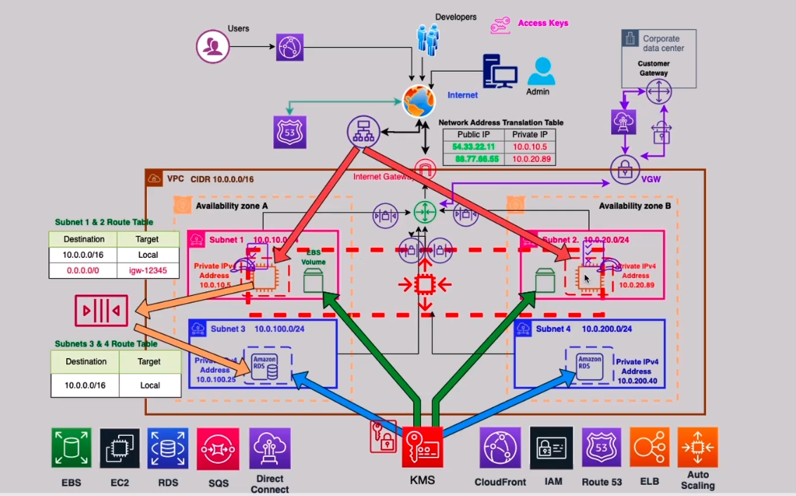

# AWS Multi-Tier Web Application

## 📌 Overview
A production-grade, highly available multi-tier web application hosted on AWS. This project demonstrates the design and implementation of a secure, scalable, and fault-tolerant architecture that spans two Availability Zones, adhering to AWS Well-Architected Framework best practices.

## 🏗️ Architecture Diagram


## 🎯 Requirements Covered
1. **Networking:** VPC `10.0.0.0/16` with 2 Public and 2 Private Subnets across 2 AZs.
2. **Security (Layer 4):** Network ACLs and Security Groups for subnet and compute-level access control.
3. **Compute:** Two EBS-backed EC2 instances (Web/App tier) managed by Auto Scaling.
4. **Access Management:** IAM Roles for EC2 (programmatic access to AWS services) and IAM Users for developers.
5. **DNS & Global Performance:** Route 53 registered domain and CloudFront for global content delivery.
6. **Database:** RDS Multi-AZ for high availability and automatic failover.
7. **Decoupling:** SQS to decouple the Web/App tier from the Database tier.
8. **Encryption:** KMS for data encryption at rest (EBS, RDS, SQS).
9. **High Availability:** Application Load Balancer (ALB) + Auto Scaling Group across 2 AZs.
10. **Hybrid Connectivity:** Virtual Private Gateway (VGW) + Site-to-Site VPN (Simulated for Corporate Datacenter).

## 🔧 AWS Services Used
| Service | Purpose |
|---------|---------|
| VPC, Subnets, IGW | Network isolation & routing |
| EC2 (Auto Scaling) | Web/App compute tier |
| EBS | Persistent storage for EC2 |
| RDS (Multi-AZ) | Managed relational database |
| SQS | Decoupling layer |
| KMS | Encryption at rest |
| IAM | Access control (Roles & Users) |
| Route 53 | DNS management |
| CloudFront | Global content delivery |
| ELB (ALB) | Load distribution |
| VGW & VPN | Hybrid connectivity (Simulated) |

## 📂 Repository Structure
```text
.
├── architecture/          # Architecture diagrams
├── screenshots/           # AWS Console screenshots (proof of implementation)
├── documentation/         # Requirements & design decisions
├── infrastructure-as-code/
│   └── terraform/         # (Planned) Terraform implementation
└── testing/               # Connectivity & validation tests